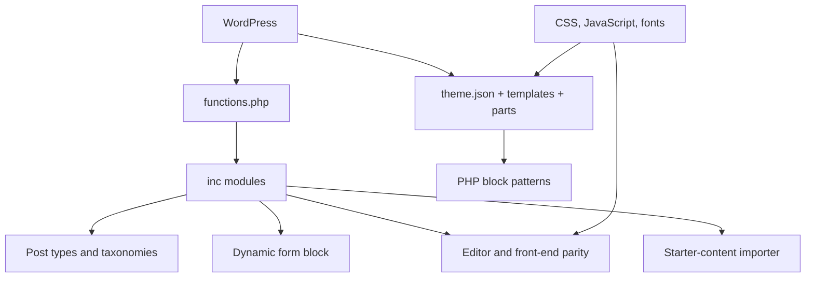

# WordPress Full Site Editing Theme

[← Project directory](https://github.com/Longspring2k/Wordpress-Projects/tree/main)

`brightpath-gutenburg` is a complete WordPress block-theme implementation built around Full Site Editing. The branch combines block templates, reusable patterns, design tokens, custom post types, dynamic forms, editor tooling, responsive navigation, and portable starter content in one theme package.

This README describes the code preserved at commit `4f65672527a99c008af144dd4cfb77d26f80d97f`. It is a source-level portfolio description, not evidence of a current production deployment.

## Technical capabilities

| Capability | Implementation evidence |
|---|---|
| Full Site Editing architecture | [`theme.json`](theme.json), [`templates/`](templates/), and [`parts/`](parts/) define global settings, 18 templates, and shared header/footer composition. |
| Reusable page sections | [`patterns/`](patterns/) contains 34 PHP block patterns for heroes, calls to action, cards, query grids, forms, property layouts, testimonials, and editorial sections. |
| Design system | [`theme.json`](theme.json) defines palettes, local variable fonts, fluid type, spacing, shadows, radii, layouts, and element styles; [`assets/css/`](assets/css/) separates 25 CSS files by responsibility. |
| Modular theme bootstrap | [`functions.php`](functions.php) loads focused modules from [`inc/`](inc/) and guards the bundled business-logic modules against duplicate loading. |
| Structured content | [`inc/post-types.php`](inc/post-types.php) registers services, resources, jobs, locations, accommodation properties, and non-public team records with supporting taxonomies and block bindings. |
| Dynamic form system | [`blocks/form/block.json`](blocks/form/block.json), [`blocks/form/render.php`](blocks/form/render.php), and [`inc/forms.php`](inc/forms.php) provide a server-rendered block, schema-driven fields, validation, nonce/timing/honeypot/rate-limit gates, protected uploads, stored submissions, retention handling, and administration screens. |
| Mail fail-closed behavior | [`inc/mail.php`](inc/mail.php) routes configured SMTP delivery and refuses to report success when no relay is configured. |
| Icon authoring | [`inc/icons.php`](inc/icons.php), [`inc/icon-meta.php`](inc/icon-meta.php), and the related editor/admin scripts expose built-in and sanitized custom icons through block and post interfaces. |
| Editor/front-end parity | [`inc/setup.php`](inc/setup.php), [`inc/design-parity.php`](inc/design-parity.php), editor parity assets, and [`assets/js/editor-canvas.js`](assets/js/editor-canvas.js) mirror theme styling and context into the Site Editor. |
| Responsive navigation and page behavior | [`inc/mobile-nav.php`](inc/mobile-nav.php), [`inc/nav-state.php`](inc/nav-state.php), and [`assets/js/mobile-nav.js`](assets/js/mobile-nav.js) implement the mobile overlay and active navigation state. |
| Portable starter content | [`starter/content.json`](starter/content.json), [`inc/starter-content.php`](inc/starter-content.php), and [`tools/export-starter.php`](tools/export-starter.php) export/import published content, terms, references, settings, and used media with ID remapping and skip-existing behavior. |

## Architecture



_Illustrative source architecture; this is not a runtime screenshot or deployment diagram._

## Directory map

```text
├── theme.json                 Global block settings and design tokens
├── style.css                 WordPress theme metadata
├── functions.php             Module loader
├── inc/                      Theme setup, models, forms, mail, icons, UI behavior
├── blocks/form/              Server-rendered custom form block
├── templates/                Full Site Editing templates
├── parts/                    Shared header and footer
├── patterns/                 Reusable PHP block patterns
├── assets/css/               Ordered front-end/editor style shards
├── assets/js/                Navigation, forms, filters, reveal and editor scripts
├── assets/fonts/             Local Figtree and Fraunces variable fonts
├── starter/content.json      Bundled content and settings snapshot
└── tools/export-starter.php  CLI exporter for a WordPress installation
```

Key entry points:

- [`functions.php`](functions.php) — loads the theme modules.
- [`inc/assets.php`](inc/assets.php) — controls ordered styles and front-end scripts.
- [`inc/post-types.php`](inc/post-types.php) — defines content models, taxonomies, and query behavior.
- [`inc/forms.php`](inc/forms.php) — owns form schemas, submission processing, storage, uploads, notifications, retention, and administration.
- [`inc/starter-content.php`](inc/starter-content.php) — imports missing bundled content and remaps references.
- [`theme.json`](theme.json) — centralizes presentation settings for the front end and editor.

## Getting started

### Prerequisites

- WordPress `6.7` or later, according to [`style.css`](style.css)
- PHP `7.4` or later
- PHP Sodium support for forms that require encrypted payload storage
- A configured SMTP relay for outgoing form notifications
- Optional integrations referenced by the original project: Advanced Custom Fields and Yoast SEO

### Install the branch

```bash
git clone --branch brightpath-gutenburg --single-branch https://github.com/Longspring2k/Wordpress-Projects.git wordpress-fse-theme
cp -R wordpress-fse-theme /path/to/wordpress/wp-content/themes/portfolio-fse
```

Activate the theme in **Appearance → Themes**. The theme queues its bundled starter-content importer on activation; administrators can also review or rerun the add-missing import from the theme’s starter-content screen under **Appearance**.

### Export starter content

The repository includes a CLI-only exporter that loads an existing WordPress installation:

```bash
php tools/export-starter.php /path/to/wordpress example.test
```

The command writes `starter/content.json` and copies only referenced media into `starter/media/`. Run it only against an installation whose content you are authorized to package.

## Verification status

This documentation was produced by static inspection of the repository tree and source. No theme activation, WordPress request, database migration, form submission, mail delivery, browser interaction, PHP script, dependency installation, or exporter execution was performed during this review.

## Current limitations

- The branch does not include an automated test suite or a local WordPress environment definition.
- The theme bundles site-specific starter content and presentation copy; review and replace that material before reuse.
- Form storage depends on WordPress database access, server configuration, scheduled events, and Sodium for encrypted fields.
- Mail delivery intentionally requires external SMTP configuration; repository inspection cannot verify deliverability.
- The exporter requires a bootable WordPress installation and writes generated content into the theme tree.
- Optional plugin integrations and current compatibility beyond the declared metadata were not runtime-tested.

## License

The theme metadata in [`style.css`](style.css) declares `GPL-2.0-or-later`, consistent with WordPress theme distribution.
